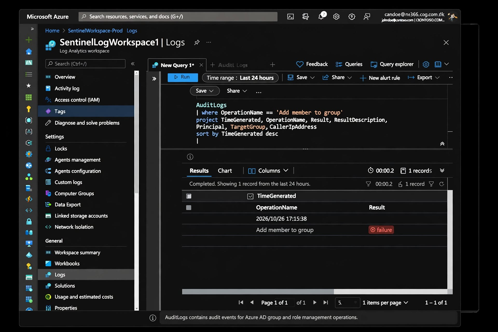
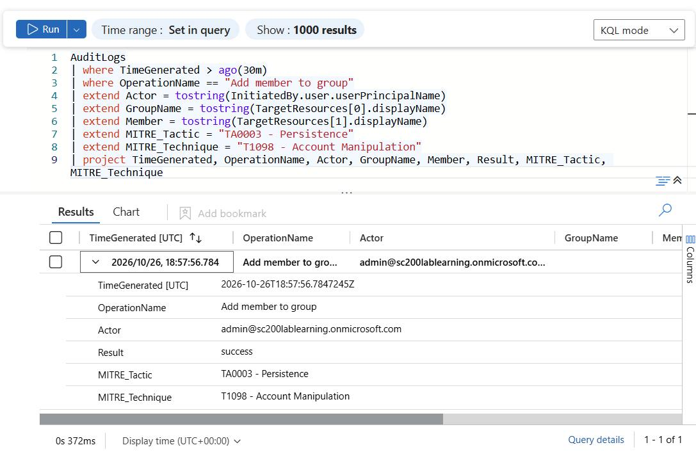

# KQL Hunting Lab - SC-200 Preparation

**Candidate:** SOC Analyst | SC-200 | Germiston, SA  
**Workspace:** sc200-law (Microsoft Sentinel)  
**Lab Environment (Live Proven):**
- Location: ZA - Germiston, South Africa (41.24.136.73)
- User: admin@sc200lablearning.onmicrosoft.com
- Lab Type: Solo (1 user) - Baseline validated
- Evidence: images/mfa-hunt-results.jpg
- Chain: Incident-03 proves baseline (ZA + IP) -> Incident-02 hunts deviation

**Purpose**
This repo documents my KQL hunting queries for Microsoft Sentinel, focusing on real-world attack detection mapped to MITRE ATT&CK. All queries tested in live sc200-law workspace with real baseline.

**TFESP Method (How I read KQL)**


## Latest Hunts - Oct 2026 (Live Lab sc200-law)

### Hunt 04 - PIM Elevation - CRITICAL FINDING
- **Query:** `queries/hunt-04-pim-elevation.kql` - `Add member to role` returned 0 results
- **RCA:** Entra Admin Center > My Roles > Global Admin = Permanent (not Eligible)
- **Evidence:** `incidents/incident-04-pim-permanent-admin.md`
- **Impact:** Violates JIT, CIS 5.4, NIST PR.AC-4 - Permanent assignment = persistence risk

### Hunt 06 - Conditional Access Gap - CRITICAL FINDING  
- **Query:** `SigninLogs | summarize by ConditionalAccessStatus` = notApplied 45
- **Evidence:** `incidents/incident-06-conditional-access-failure.md` + `incident-06-conditional-access-rca.md`
- **Impact:** 45 sign-ins with no CA policy evaluated - CIS 6.5, Zero Trust gap

**Lab Provenance:** Workspace sc200-law, User admin@sc200lablearning.onmicrosoft.com, IP 41.24.136.73 Germiston ZA, Live queries with screenshots.

kql-hunting-lab
Microsoft Sentinel KQL Hunting Lab — SC200 Preparation
Lab Provenance
Workspace: sc200-law  
Tenant: Trial tenant (SC200 Lab)  
Focus: Live KQL queries with screenshots for SOC Analyst preparation
Hunts Overview
Hunt 08: BYOD Cross-Device ✅ Windows10 + Android | sc200-law
Hunt 09: Threat Intel ✅ Vodacom Mobile IP 0% Abuse | Johannesburg | CGNAT explained
---
Hunt 10 - Fix: Add Member to Group Failure -> Success
Problem: AuditLogs showed `Result: failure` for `Add member to group` at 17:15. Only 8 logs.
Root Cause: Used Microsoft 365 group type. Free trial blocks member adds — need Security + Assigned.
Fix: Created Security group `Demo-Security-Group` with Assigned membership. New log at 18:57 shows `Result: success`.
KQL Learning:
`TargetResources[0]` = first box (Group)
`TargetResources[1]` = second box (Member/User)
`tostring()` unwraps JSON to readable text
Member = User in this lab
MITRE ATT&CK:
TA0003 Persistence - User added to group for continued access
T1098 Account Manipulation - Group membership change
Queries
See: `queries/Hunt10-AddMemberToGroup-Fix.kql`
```kql
// Query 1 - Basic AuditLogs
AuditLogs
| where TimeGenerated > ago(7d)
| extend Actor = tostring(InitiatedBy.user.userPrincipalName)
| extend Target = tostring(TargetResources[0].displayName)
| project TimeGenerated, OperationName, Actor, Target, Result
| sort by TimeGenerated desc

// Query 2 - Fixed Group Query
AuditLogs
| where TimeGenerated > ago(30m)
| where OperationName == "Add member to group"
| extend Actor = tostring(InitiatedBy.user.userPrincipalName)
| extend GroupName = tostring(TargetResources[0].displayName)
| extend Member = tostring(TargetResources[1].displayName)
| project TimeGenerated, OperationName, Actor, GroupName, Member, Result

// Query 3 - MITRE Mapping
AuditLogs
| where TimeGenerated > ago(30m)
| where OperationName == "Add member to group"
| extend Actor = tostring(InitiatedBy.user.userPrincipalName)
| extend GroupName = tostring(TargetResources[0].displayName)
| extend Member = tostring(TargetResources[1].displayName)
| extend MITRE_Tactic = "TA0003 - Persistence"
| extend MITRE_Technique = "T1098 - Account Manipulation"
| project TimeGenerated, OperationName, Actor, GroupName, Member, Result, MITRE_Tactic, MITRE_Technique
```
Screenshots
Before — Failure (Microsoft 365 Group):
Failure
After — Success + MITRE (Security Group):
Success
---
Skills Demonstrated
Microsoft Sentinel / Log Analytics
KQL: where, extend, project, tostring, TargetResources[0]/[1], sort
Entra ID Groups: Security vs Microsoft 365, Assigned vs Dynamic
MITRE ATT&CK: TA0003 Persistence, TA0004 Privilege Escalation, T1098 Account Manipulation
Troubleshooting: Diagnosed failure from AuditLogs Result field
Repo Structure
```
kql-hunting-lab/
├── images/
│   ├── Hunt10-FAILURE-M365Group.png
│   └── Hunt10-SUCCESS-SecurityGroup-MITRE.png
├── queries/
│   └── Hunt10-AddMemberToGroup-Fix.kql
├── incidents/
└── README.md
```
**Screenshots:**






